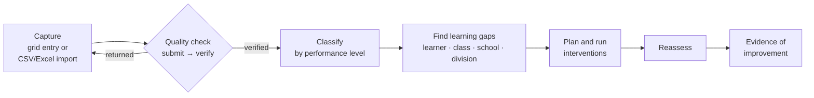

# e-QUAART · Electronic Quality Assured Assessment Result Tool

**Assessment results management, analytics and intervention tracking for a schools division.**
Built by [Miguel Jay Faustino](https://miguel-jay-faustino.vercel.app).

> This repository holds the story and the product documentation only. The source code is private because the system is designed to hold learner personal data. Everything described here runs in the private build; every figure below comes from its fictional demo dataset.

---

## The problem

Schools run several reading and math assessments in a year: CRLA, Phil-IRI, RMA, ELLNA, the end-of-term Learners Outcome Assessment, and Kindergarten checklists. Each one lives in its own spreadsheet, typed by a different person, in a slightly different format.

That makes three questions almost impossible to answer:

1. **Which learners, classes and schools are behind, and in what?** The results are never in one place, and the same "Tier 3" means different things on different instruments.
2. **Can we trust the numbers?** Nobody checks a result before it lands in a report.
3. **Did the intervention work?** The plan, the sessions and the reassessment sit in separate files, if they're written down at all.

## What e-QUAART does

It turns assessment results into instructional action, in one flow:

- **Capture.** Advisers type results into a grid or import a CSV/Excel file. Every row is checked against a schema before it touches the database, and import errors come back row by row.
- **Quality check.** A result is a draft until it's submitted, and it only feeds analytics once someone other than the encoder verifies it. Verified results are locked, and every change is logged.
- **Classify.** Each instrument has its own configurable performance levels. Percentage instruments use bands; profile instruments (CRLA, Phil-IRI, RMA) map the recorded descriptor straight to a level, so no percentage rule is ever applied to them.
- **Find gaps.** Gaps are derived per learner and competency, then rolled up to class, school and division patterns, including gaps that persist across terms.
- **Intervene and reassess.** Interventions carry a baseline, sessions, attendance and a reassessment, so effectiveness is measured, not assumed.

## The data decisions that mattered

| Decision | Why |
|---|---|
| **Validation at the door** | Bad rows are cheaper to reject on import than to explain in a report. |
| **A verify step before analytics** | Unchecked results stay out of every chart, so a dashboard number always means a checked number. |
| **Rules as configuration** | Performance levels, curriculum and who encodes what are settings. A new instrument or a revised cut-off doesn't need a code change, and saving a change re-classifies existing results in one audited transaction. |
| **One definition per metric** | Proficiency, at-risk rate, completion, coverage and improvement are each defined once and reused everywhere, so they agree across screens and reports. |
| **Idempotent year-end rollover** | Moving learners into the next school year can be re-run safely without moving anyone twice. |
| **Storage sized to the user** | A single-file build runs on a school laptop with no admin rights; a server build handles division-wide concurrent encoding. |
| **Privacy by design** | Role-scoped access for 10 user types, small-cell suppression in aggregates, a full audit trail and a Data Protection Officer workspace. |

## By the numbers (fictional demo data)

| | |
|---|---|
| Results | ~79,000 |
| Learners | ~2,600, with three school years of history |
| Interventions tracked | ~1,400, with sessions, attendance and reassessments |
| Schools | 9, in 3 districts |
| Report types | 10, in CSV, Excel and PDF |
| User roles | 10 |

## Stack

TypeScript · Node.js · Express · Prisma · SQLite and PostgreSQL · React · Recharts · Vitest · Docker Compose · GitHub Actions

## Read more

- [How it works](docs/how-it-works.md): classification, gap detection and metric definitions
- [Roles and privacy](docs/roles-and-privacy.md): who sees what, and how learner data is protected
- [What's next](docs/roadmap.md): what is built, and what is deliberately left for later

---

Want a walkthrough of the private build? [Get in touch through my portfolio](https://miguel-jay-faustino.vercel.app/#contact).
